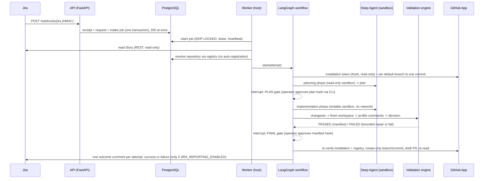

# Architecture

**1 LangGraph workflow + 1 Deep Agent + 1 independent Python validation engine**, in one deployable Python application with two processes:

- **API** (FastAPI): Jira webhook intake and health checks. It never runs agents.
- **Worker**: a trusted host process that runs jobs, the workflow and the sandboxes.

### Components

| Component | Technology | Role |
|---|---|---|
| Agent API | Python / FastAPI | Jira webhook intake and health checks; never runs agents |
| Workflow | Python / LangGraph | One workflow per attempt, gates, retries |
| Coding agent | Python / Deep Agents | Plans and implements inside the sandbox |
| Execution sandbox | Python Docker image (`execution-python:0.2.0`) | Offline, hardened; runs **Python repositories only** |
| Validation | Python, independent of the agent | Fresh offline container; runs the profile's Python commands |
| Studio UI | React / TypeScript / Node.js (Vite) | Development UI to watch the agent; Node.js is a local development requirement only, not an execution toolchain |
| Database | PostgreSQL | Requests, jobs, attempts, artifacts index, cost ledger |

**Scope:** multi-repository means several registered **Python** repositories per Story (for example a backend API and a Python client, SDK or worker). Node.js, React/Next.js, Android, Kotlin/Java, Flutter and iOS/Swift repositories are out of scope.

## Flow



## Components

| Package | Responsibility |
|---|---|
| `api/`, `main.py` | Webhook route (`POST /webhooks/jira`), health, request ids |
| `application/webhooks`, `domain/webhooks` | HMAC verification, scope policy, durable receipt, duplicate suppression |
| `application/jobs`, `persistence/repositories/job_queue.py` | Durable job queue and worker (leases, heartbeat, retries, dead jobs) |
| `application/changes`, `domain/changes` | Requests, attempts, state machine, hash-bound approvals |
| `application/repositories`, `domain/repositories`, `cli/` | Registry, profiles, command policy, resolver, operator CLI |
| `integrations/jira` | Read-only REST client, issue mapping, ADF, webhook signature, outcome reporter |
| `integrations/github` | App auth, baseline reader (pinned commit), reference parser, registration client, publisher |
| `orchestration/langgraph` | The parent graph, state, nodes, routing, Postgres checkpointer, runner |
| `orchestration/steps.py` | Workflow steps (application services the nodes call) |
| `agents/coding` | The one Deep Agent (`create_deep_agent`), prompts, schemas |
| `execution/` | Workspace runtime, Docker sandbox backend (`BaseSandbox`), file safety, artifacts |
| `validation/` | Changeset rules, secret scan, fresh rebuild, profile commands, PR eligibility |
| `providers/llm` | Chat model factory: Anthropic (local/test) or AWS Bedrock (staging/production) |

## Attempt states

`PENDING -> PREPARING -> PLANNING -> AWAITING_PLAN_APPROVAL -> IMPLEMENTING -> VALIDATING -> AWAITING_FINAL_APPROVAL -> DELIVERING -> REPORTING -> COMPLETED`

- A bounded repair loops `VALIDATING -> IMPLEMENTING`.
- Terminal states: `COMPLETED`, `BLOCKED`, `FAILED`, `CANCELLED`, `REJECTED`.
- Every transition goes through the domain (`CodeChangeAttempt.transition`).
- Database triggers keep:
  - the pinned base commit immutable;
  - approvals append-only;
  - attempts undeletable;
  - terminal attempts frozen.

## State and persistence

- **Domain tables** (`public` schema) are the source of truth for decisions and status.
- **LangGraph checkpoints** live in the `langgraph` schema. Thread id: `attempt:<id>`.
- **The Deep Agent's runs** checkpoint under their own thread ids (`attempt:<id>:planning`, `attempt:<id>:implementation:<n>`). They do not share the parent's checkpoint.
- **Artifacts** (plan, changeset, implementation report, validation report, manifest, delivery result) are scoped by request and attempt, hash-verified and redacted.

## Why the agent cannot validate itself

The engine never reads the agent's report. It works from three things:

- the changeset the **platform** extracted from the sandbox workspace;
- the approved plan;
- the published profile.

It rebuilds a fresh workspace from the pinned baseline, applies the changeset, proves the tree equals baseline plus changes, and runs the profile's commands in a new network-less container.

## Future worker deployment

The worker controls a container runtime, so it is privileged control plane. Options for production:

1. A dedicated host or VM worker, with the Docker daemon not shared with anything else.
2. A remote sandbox service, e.g. a microVM or Kubernetes sandbox backend, behind the same `SandboxStarter` protocol, so the worker needs no local daemon.
3. A rootless Docker or Podman daemon per worker host.

Do not mount the Docker socket into a general-purpose container, and never into a sandbox.

## Multi-repository Stories and research

```
Jira Story --webhook--> API --job--> worker: IntakeHandler
   one Repository: marker  -> single attempt (unchanged)
   several markers         -> Coordinator (application/multirepo): resolve all, DAG, parent row
                               -> code_change.child jobs (one per repository, bounded parallel)
                                  -> same LangGraph workflow per child attempt (own workspace,
                                     Python execution image, Deep Agent thread, validation, draft PR)
                               -> contracts (artifacts) to dependents -> one aggregated Jira comment
Deep Agent tools (worker side, sandbox stays offline): search_docs, fetch_reference
```

Still one workflow, one Deep Agent and one validation engine. Every child is a Python repository. See [MULTI-REPOSITORY.md](MULTI-REPOSITORY.md), [PYTHON-EXECUTION-AND-RESEARCH.md](PYTHON-EXECUTION-AND-RESEARCH.md), [ADR-013](decisions/ADR-013-multi-repository-fan-out.md).
